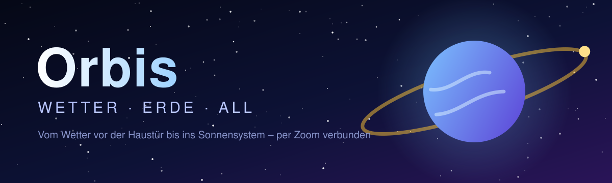
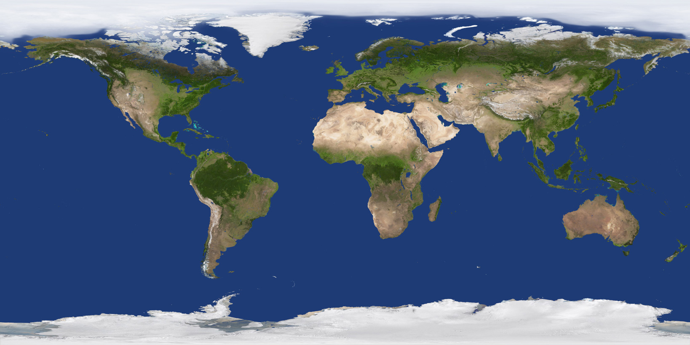
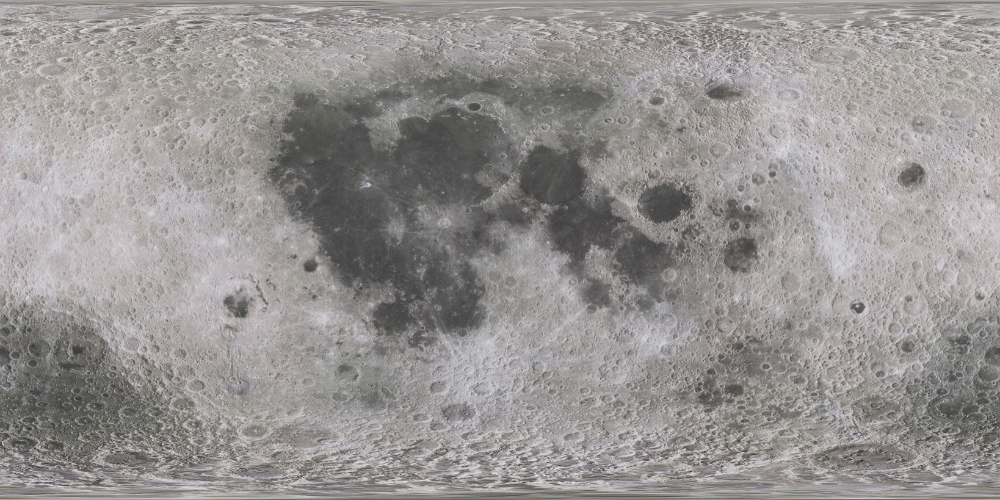
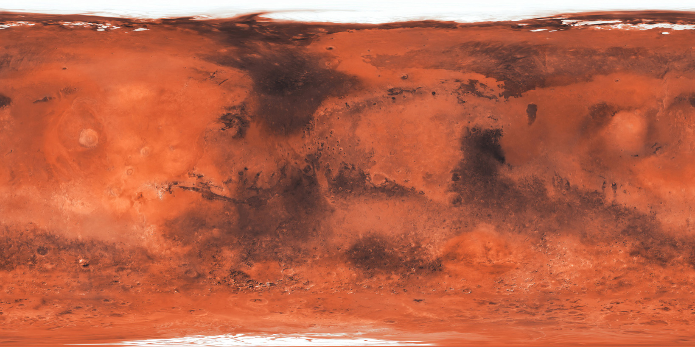
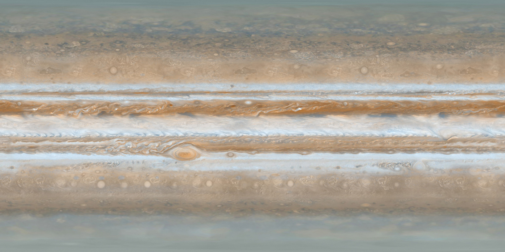

<div align="center">



<br>

[](https://malte9799.github.io/orbis/)
[](docs/DATENQUELLEN.md)

[](https://github.com/malte9799/orbis/actions/workflows/deploy.yml)
[](https://github.com/malte9799/orbis/actions/workflows/data.yml)


**Vom Wetter vor der Haustür über die Live-Weltkarte bis ins Sonnensystem –
in einer App und nahtlos per Zoom verbunden.**

[Features](#-features) · [Ansichten](#-die-drei-ansichten) · [Ebenen](#-ebenen-der-karte) · [Weltall](#-weltall-im-detail) · [Datenquellen](docs/DATENQUELLEN.md) · [Entwicklung](#-entwicklung) · [Deployment](#-deployment)

</div>

---

## 🖼️ Vorschau

<table>
  <tr>
    <td align="center" width="25%"><br><b>🌍 Erde</b><br><sub>Wetter, Live-Karte, Globus</sub></td>
    <td align="center" width="25%"><br><b>🌕 Mond</b><br><sub>LRO-Mosaik, Apollo-Landestellen</sub></td>
    <td align="center" width="25%"><br><b>🔴 Mars</b><br><sub>Rover-Spuren, HiRISE, CTX</sub></td>
    <td align="center" width="25%"><br><b>🪐 Sonnensystem</b><br><sub>Planeten, Monde, Raumsonden</sub></td>
  </tr>
</table>

<sub>Texturen: [Solar System Scope](https://www.solarsystemscope.com/textures/) (CC BY 4.0) · Details in den [Datenquellen](docs/DATENQUELLEN.md#11-weltall-daten-karten--texturen).</sub>

## ✨ Features

| | |
|---|---|
| ☁️ **Wetter** | Aktuell, 48-h-Diagramm, 14-Tage-Vorhersage, Wind, UV, Luftqualität, Pollen, Sonnenzeiten, amtliche Warnungen (DWD, NWS) |
| 🗺️ **Live-Karte** | 2D oder Globus, Radar, Satellit, Vorhersage bis +5 Tage mit Zeitleiste, Windströmung, Isobaren |
| 🌋 **Ereignisse** | Erdbeben, Vulkane, Waldbrände, Stürme, Tsunamis, Blitze live, Polarlicht, Radioaktivität |
| ✈️ **Verkehr** | Flugzeuge, Schiffe, Züge, Busse & Bahnen live, Staus, Verkehrsnetze, Raketenstarts |
| 📷 **Kameras & Radio** | Tausende Webcams, über 50.000 Radiosender im eingebauten Player |
| 🏗️ **Infrastruktur** | Seekabel, Internetknoten, Kraftwerke, Pipelines, Rohstoffe, Geologie |
| 🚀 **Weltall** | 3D-Sonnensystem, Raumsonden mit Flugbahnen, ISS & Satelliten live, Mond- und Mars-Karte mit Rovern |
| 🔌 **Ohne Anmeldung** | Alle Kernquellen sind kostenlos; optionale Schlüssel nur für Extras |

> 📚 **Woher kommen die Daten?** Die vollständige Liste aller Quellen mit Links, Lizenzen und Verwendung:
> **[docs/DATENQUELLEN.md](docs/DATENQUELLEN.md)**

## 🧭 Die drei Ansichten

### 🌦️ Vorhersage

Aktuelles Wetter, 48-Stunden-Diagramm, 14-Tage-Vorhersage, Wind, UV, Luftqualität, Pollen,
Sonnenauf-/-untergang und amtliche Unwetterwarnungen (DWD für Deutschland, NWS für die USA).
Ortssuche, eigener Standort und Favoriten.

### 🗺️ Karte

Interaktive Wetterkarte nach dem Vorbild von zoom.earth – standardmäßig 2D, per Schalter **2D / 3D** auch als Globus.

- Live-Ebenen und Vorhersage-Ebenen mit Zeitleiste (bis +5 Tage, abspielbar)
- Animierte Windströmung, Isobaren und Naturereignisse
- Wert unter dem Mauszeiger, Klick zeigt das Wetter an dieser Stelle

### 🚀 Weltall

3D-Sonnensystem (ähnlich NASA „Eyes on the Solar System“). Wer im 3D-Globus weiter herauszoomt, landet
automatisch hier; Hineinzoomen auf die Erde führt zurück zur Wetterkarte.

| | |
|---|---|
| 🪐 **Körper** | Sonne, alle Planeten, Pluto, wichtige Monde und Asteroiden mit Steckbrief, Abstand zu Sonne/Erde, Lichtlaufzeit |
| 🛰️ **Raumsonden** | Voyager 1/2, New Horizons, Pioneer 10/11, Parker Solar Probe, JWST, SOHO, Juno, Perseverance, Curiosity, Europa Clipper, JUICE, BepiColombo – mit Flugbahnen |
| 🌍 **Erdnähe** | ISS, Hubble, Wetter-, GPS-, Galileo-Satelliten live aus CelesTrak-Bahndaten |
| ⏱️ **Zeitstrahl** | Datum wählen, abspielen von Echtzeit bis 1 Jahr pro Sekunde (auch rückwärts) |
| 🚩 **Landestellen** | Flaggen an allen Mond- und Mars-Landestellen, erst ab dem Landedatum sichtbar |
| 🗺️ **Planetenkarten** | Mond (`#/planet?body=moon`) und Mars (`#/planet?body=mars`) wie die Erdkarte bedienbar |

<details>
<summary><b>🔭 Weltall im Detail</b> (Mond, Mars, Planetenkarte, 3D-Modelle, Genauigkeit)</summary>

<br>

#### 🌕 Mond

- Hohe Auflösung: LRO-Farbmosaik (4k/8k) mit Relief aus dem LOLA-Höhenmodell
  ([NASA CGI Moon Kit](https://svs.gsfc.nasa.gov/4720), wird beim Deploy geladen) und beim Heranzoomen nachgeladene
  Kacheln des LRO-WAC-Mosaiks (≈ 100 m/Pixel, [NASA Moon Trek](https://trek.nasa.gov/moon/)) – Zoom bis ≈ 20 km über die Oberfläche.
- Flaggen an allen Landestellen (Apollo 11–17, Luna, Surveyor, Chang’e, Chandrayaan-3, SLIM, Odysseus, Blue Ghost, Athena)
  mit Steckbrief. Direktlink z. B. `#/weltall?focus=moon&site=apollo11`.
- **Mondkarte** (`#/planet?body=moon`): LRO-WAC-Mosaik, optional die farbige Reliefkarte aus LOLA/Kaguya,
  ~70 benannte Formationen (Meere, Becken, Krater, Gebirge, Täler – `src/space/moon-features.ts`, schaltbar) und alle Landestellen.
- 3D-Modelle von Lander, Flagge und Fahrzeugen (Apollo-Landefähre und Mondauto, Surveyor, Luna/Lunochod, Chang’e/Yutu,
  Vikram/Pragyan, SLIM, Odysseus, Blue Ghost …) – prozedural erzeugt (`src/space/surface-models.ts`) und per Klick anwählbar.
- Regionale Detailkarten (LROC-NAC-Mosaike der Landestellen, Kaguya, Geologie, Mineralien …) liest
  `scripts/moon-products.mjs` aus dem Moon-Trek-Index nach `src/space/moon-products.ts`; der Deploy-Workflow führt das Skript
  aus (optional, bei Fehlern bleibt die eingecheckte Liste). Die Mosaike liegen in „Automatisch“ über dem WAC-Mosaik.

#### 🔴 Mars

- Landestellen (Viking, Pathfinder, Spirit, Opportunity, Phoenix, Curiosity, InSight, Perseverance, Zhurong) mit Steckbrief.
- Beim Heranzoomen nachgeladene Kacheln: Farbmosaik ([NASA Mars Trek](https://trek.nasa.gov/mars/)) und das 5-m-CTX-Mosaik
  (NASA/JPL/MSSS/Caltech Murray Lab, via Esri). Darüber automatisch die regionalen HiRISE-Mosaike (Jezero, Gale, Landestellen,
  Rover-Gebiete – bis 25 cm/px).
- Perseverance, Curiosity und Ingenuity stehen auf der Oberfläche (aufrecht, mit dem Planeten mitdrehend); ihre Fahrspuren und
  die 72 Ingenuity-Flüge aus den NASA-MMGIS-Daten sind eingezeichnet und folgen der Zeitleiste (Sol, gefahrene Strecke im Steckbrief).
  Fahrspuren: `scripts/mars-traverse.mjs` (Daten-Branch, Rückfall `public/data/mars-traverse.json`).

#### 🗺️ Planetenkarte

`#/planet?body=mars` bzw. `moon` – bedient sich wie die Erdkarte (MapLibre):

- 2D-Karte oder 3D-Globus, Ziehen verschiebt, Zoom zum Mauszeiger, Ebenen-Panel, Suche und Maßstab.
- Kartentyp-Wechsler nur mit echten Basiskarten (Automatisch, Farbmosaik, CTX ≈ 5 m, Höhe & Tiefe MOLA/HRSC, Infrarot THEMIS,
  HRSC-Farbmosaike am Kartenmittelpunkt). Überlagerungen (Geologie, Täler, Mineralien) und Markierungen schaltet das Ebenen-Panel;
  eine Leiste unten zeigt, was gerade dargestellt wird.
- Herauszoomen aus dem Globus bzw. das Weltall-Symbol führt ins Sonnensystem, Hineinzoomen auf den Mars von dort auf die Karte.
  Aus der Weltall-Ansicht öffnet sich die Mondkarte beim Heranzoomen bis dicht über die Oberfläche (`openAt`).
- Rover erscheinen beim Heranzoomen als 3D-Modell, mit der Zoomstufe mitskalierend (ab ca. Zoom 7 in 2D bzw. 11 im Globus,
  bei sehr hoher Zoomstufe in Originalgröße; `modelPx` in `views/planetmap.ts`).
- In der Weltall-Ansicht haben die Planeten nur ihre feste Textur; Detailkacheln gibt es nur auf der Karte
  (`src/space/planets.ts`: `enabled` – derzeit Erde, Mars und Mond, Merkur/Venus vorbereitet).
- Die Trek-Produktliste stammt aus Trek selbst (`scripts/mars-products.mjs` → `src/space/mars-products.ts`) und ist kuratiert
  (Duplikate, sehr grobe TES-Karten und regionale CTX-/Hillshade-Fragmente entfallen).
  Die Quellen sind Äquirektangular-Kacheln und werden per `planet://`-Protokoll in Mercator-Kacheln umgerechnet.

#### 🧊 3D-Modelle

NASA ([NASA 3D Resources](https://github.com/nasa/NASA-3D-Resources), frei verwendbar) und ESA für JUICE und BepiColombo
(Cosmographia-Modelle aus den [ESA SPICE-Daten](https://spiftp.esac.esa.int/data/SPICE/), © ESA) für James-Webb-Teleskop,
Hubble, ISS, Voyager, Pioneer, Parker Solar Probe, Juno, Perseverance/Curiosity und LRO.

- Sie werden erst geladen, wenn man ein Objekt anwählt oder nah genug heranzoomt.
- Die ISS erscheint zunächst klein, dann als detailliertes NASA-Modell (≈ 96 MB, beim Deploy geladen).
- Große Modelle (Rover, JWST, Europa Clipper …) haben eine Schnellvariante (`*-lite.glb`), die vom Original abgelöst wird.
- Hubble und ISS mit Live-Position.

#### 🎯 Genauigkeit

Planetenpositionen stammen aus den JPL-Näherungsformeln (Standish, ±wenige Bogenminuten 1800–2050), der Mond aus der
Näherung des Astronomical Almanac. Bahnen der Raumsonden sind vereinfacht und als „angenähert“ gekennzeichnet, da es keine
kostenlose, browsertaugliche Bahndaten-API gibt. Asteroiden nutzen Bahnelemente der
[JPL Small-Body Database](https://ssd.jpl.nasa.gov/tools/sbdb_lookup.html) in Zweikörper-Näherung.

</details>

## 🗂️ Ebenen der Karte

Alle Quellen sind kostenlos und ohne Anmeldung nutzbar. Jede Quelle mit Link, Lizenz und Zweck steht in der
**[detaillierten Datenquellen-Liste](docs/DATENQUELLEN.md)** – hier die Kurzfassung:

| Bereich | Ebenen | Quellen |
|---|---|---|
| 🗺️ **Karte** | Dunkel/Hell, Satellit, Sentinel-2, Topografie, NASA-Tagesbild, Tag/Nacht, 3D-Gelände | [OpenFreeMap](https://openfreemap.org), [Esri](https://server.arcgisonline.com), [EOX](https://s2maps.eu), [OpenTopoMap](https://opentopomap.org), [NASA GIBS](https://earthdata.nasa.gov/eosdis/science-system-description/eosdis-components/gibs), [AWS Terrain](https://registry.opendata.aws/terrain-tiles/) |
| ☁️ **Wetter** | Wind, Böen, Temperatur, Feuchte, Niederschlag, Bewölkung, Luftdruck, Schnee, CAPE – bis +5 Tage, Windpartikel, Isobaren | [Open-Meteo](https://open-meteo.com) |
| 📡 **Radar & Satellit** | Regenradar weltweit, DE, USA (inkl. Alaska, Hawaii, Karibik, Guam), Kanada, Finnland, Japan; Satellit Infrarot; Niederschlag | [RainViewer](https://www.rainviewer.com/api.html), [DWD](https://maps.dwd.de), [IEM/NOAA](https://mesonet.agron.iastate.edu), [Environment Canada](https://eccc-msc.github.io/open-data/msc-geomet/readme_en/), [FMI](https://en.ilmatieteenlaitos.fi/open-data), [NOAA MRMS](https://www.nssl.noaa.gov/projects/mrms/), [JMA](https://www.jma.go.jp/bosai/nowc/), [EUMETSAT](https://view.eumetsat.int), [NASA GPM](https://gpm.nasa.gov/data/imerg) |
| 🚨 **Warnungen** | Unwetter DE, Bevölkerungswarnungen, Tsunami, Katastrophen | [DWD](https://www.dwd.de), [NINA/BBK](https://warnung.bund.de), [NOAA](https://www.tsunami.gov), [GDACS](https://www.gdacs.org) |
| 🌋 **Ereignisse** | Waldbrände, Hotspots, Stürme, Tornados, Vulkane, Fluten, Erdbeben (EU ab M 1,5, weltweit ab M 2,5) | [NASA EONET](https://eonet.gsfc.nasa.gov)/[FIRMS](https://firms.modaps.eosdis.nasa.gov), [USGS](https://earthquake.usgs.gov), [EMSC](https://www.emsc-csem.org), [Smithsonian GVP](https://volcano.si.edu), [NIFC](https://data-nifc.opendata.arcgis.com) |
| ⚡ **Blitze & Strahlung** | Blitze live (15 min), Radioaktivität (ODL, EURDEP, Safecast), Polarlicht/Kp, Sonnenwind | [Blitzortung](https://www.blitzortung.org), [BfS](https://odlinfo.bfs.de), [EURDEP](https://remap.jrc.ec.europa.eu), [Safecast](https://safecast.org), [NOAA SWPC](https://www.swpc.noaa.gov) |
| 🌱 **Erde & Umwelt** | Geologie, Plattengrenzen, Rohstoffe, Landbedeckung, Vegetation, Schnee, Aerosole, Nachtlichter | [Macrostrat](https://macrostrat.org), [USGS MRDS](https://mrdata.usgs.gov/mrds/), [BGR](https://services.bgr.de), [Wikidata](https://www.wikidata.org), [ESA WorldCover](https://esa-worldcover.org), NASA GIBS |
| 🌊 **Meer & Gewässer** | Seegang, Strömung, Flussabfluss, Pegel, Bojen, Gezeiten, Meerestiefe, Algenblüte, Meerestemperatur, Meereis | [Open-Meteo Marine/Flood](https://open-meteo.com), [PEGELONLINE](https://www.pegelonline.wsv.de), [NOAA NDBC](https://www.ndbc.noaa.gov), [CO-OPS](https://tidesandcurrents.noaa.gov), [GEBCO](https://www.gebco.net), [EMODnet](https://emodnet.ec.europa.eu) |
| ✈️ **Luftraum** | Flugzeuge, Hubschrauber, Ballone, Drohnen live; Flughäfen; Wetterballons; Raketenstarts; Satelliten | [adsb.lol](https://adsb.lol), [adsb.fi](https://adsb.fi), [airplanes.live](https://airplanes.live), [OpenSky](https://opensky-network.org), [SondeHub](https://sondehub.org), [Launch Library 2](https://thespacedevs.com), [CelesTrak](https://celestrak.org) |
| 🚆 **Verkehr** | Schiffe (AIS), Züge, Busse, Trams, U-Bahnen live; Autobahn-Staus; Schiffsrouten | [Digitraffic](https://www.digitraffic.fi), [Transitous](https://transitous.org), [Amtraker](https://amtraker.com), [Entur](https://developer.entur.org), [MBTA](https://api-v3.mbta.com), [SEPTA](https://www3.septa.org), [Autobahn GmbH](https://verkehr.autobahn.de) |
| 🛤️ **Verkehrsnetze** | Straßen, Bahn (Tempo, Elektrifizierung), ÖPNV-Linien, Rad- und Wandernetz | [OpenStreetMap](https://www.openstreetmap.org), [OpenRailwayMap](https://www.openrailwaymap.org), [Waymarked Trails](https://waymarkedtrails.org) |
| 📷 **Kameras** | Webcams weltweit (u. a. London, New York, Kalifornien, Hongkong, Singapur), ALPR-Kameras | [Digitraffic](https://weathercam.digitraffic.fi), [TfL](https://api.tfl.gov.uk), [Caltrans](https://cwwp2.dot.ca.gov), [ALERTCalifornia](https://cameras.alertcalifornia.org), [DeFlock](https://deflock.org) |
| 📻 **Radio** | Über 50.000 Sender im Player | [Radio Browser](https://www.radio-browser.info) |
| 🏗️ **Infrastruktur** | Seekabel, Internetknoten, Kraftwerke, Windräder, Pipelines | Seekabel aus [OpenStreetMap](https://www.openstreetmap.org/copyright), [PeeringDB](https://www.peeringdb.com), [WRI GPPD](https://datasets.wri.org/dataset/globalpowerplantdatabase), OSM |

### 🔑 Optional mit kostenlosem Schlüssel

Im Ebenen-Panel unter „Erweitert“; Schlüssel werden nur im `localStorage` des Browsers gespeichert.

- **OpenWeatherMap** → zusätzliche hochauflösende Wetterkarten
- **NASA FIRMS** `MAP_KEY` → einzelne Feuer-Hotspots als anklickbare Punkte
- **aisstream.io** → Schiffe weltweit · **Windy Webcams** → weltweite Webcams · **Transport Victoria / CTA / Trafiklab** → Melbourne, Chicago, Schweden

Der kostenlose RainViewer-Zugang ist seit 2026 auf Zoom 7 beschränkt. Unter „Erweitert“ kann ein eigener
RainViewer-kompatibler Radar-Server (z. B. selbst gehostetes [LibreWXR](https://github.com/JoshuaKimsey/LibreWXR)) eingetragen werden.

## 🛠️ Entwicklung

```bash
npm install
npm run dev       # Entwicklungsserver
npm run build     # Typecheck + Produktions-Build nach dist/
npm run preview   # Build lokal ansehen
```

**Technik:** Vite, TypeScript (ohne Framework), [MapLibre GL JS 6](https://maplibre.org/) mit Globus-Projektion,
[three.js](https://threejs.org/) für das Sonnensystem (wird erst beim Öffnen geladen). Die Modellfelder werden über ein
eigenes Kachel-Protokoll (`wxfield://`) im Browser gerendert, der Wind als Partikelanimation auf einem Canvas über der
Karte gezeichnet, Isobaren per Marching Squares.

| Ordner | Inhalt |
|---|---|
| `src/views/` | Ansichten: Vorhersage, Karte, Planetenkarte |
| `src/api/` | Datenabrufe (Wetter, Ereignisse, Verkehr, Kameras …) |
| `src/globe/` | Karten-Ebenen, Stil, Popups, Zeitleiste |
| `src/space/` | Sonnensystem, Ephemeriden, Mond/Mars, Raumsonden |
| `scripts/` | Daten-Snapshots, Trek-Produktlisten, Bahn- und Modell-Skripte |
| `proxy/` | Cloudflare-Worker (Daten-Proxy) |
| `docs/` | Banner und [Datenquellen-Liste](docs/DATENQUELLEN.md) |

## 🚢 Deployment

Alles läuft über GitHub Actions und den Branch `gh-pages` (Repo-Einstellungen → *Pages → Source*: „Deploy from a branch“
→ `gh-pages` / root):

| Workflow | Auslöser | Aufgabe |
|---|---|---|
| `deploy.yml` | Push auf jeden Branch | baut die App; `main` → Seite, andere Branches → `preview/<branch>/`, mit Status-Kommentar im PR |
| `pr-preview.yml` | PR geöffnet | Status-Kommentar, falls die Vorschau schon fertig war |
| `preview-cleanup.yml` | PR geschlossen, Branch gelöscht, wöchentlich | entfernt nicht mehr benötigte Vorschauen |
| `data.yml` | alle 15 min | Daten-Snapshots im Branch `data` |

Alle Änderungen an `gh-pages` laufen über `scripts/gh-pages.sh`, das gleichzeitige Läufe sicher zusammenführt.

<details>
<summary><b>☁️ Daten-Proxy (Cloudflare Worker, empfohlen)</b></summary>

<br>

adsb.fi, airplanes.live und OpenSky erlauben keine Abrufe direkt aus dem Browser (CORS), adsb.lol drosselt schnell, und die
öffentlichen Overpass-Server (OpenStreetMap-Ebenen) lassen pro Nutzer nur wenige Anfragen zu. `proxy/cloudflare-worker.js`
löst das: Er ergänzt die CORS-Header und speichert Antworten zwischen (Flugdaten ~8 s, Overpass 15 min), sodass viele
Besucher am selben Ort nur eine Anfrage auslösen. Auch NOAA NDBC (Messbojen) und NOAA CO-OPS (Gezeitenpegel) laufen über den
Proxy; nach einem Update des Proxy-Codes muss der Worker neu deployt werden. Der kostenlose Cloudflare-Tarif erlaubt
100.000 Anfragen pro Tag.

1. Auf [dash.cloudflare.com](https://dash.cloudflare.com) kostenlos registrieren.
2. *Compute (Workers) → Workers & Pages → Create → Worker* („Start with Hello World“), Namen vergeben
   (z. B. `orbis-proxy`) → *Deploy*.
3. *Edit code*: den Inhalt komplett durch `proxy/cloudflare-worker.js` ersetzen → *Deploy*.
   Die Adresse lautet dann `https://orbis-proxy.<dein-konto>.workers.dev/`.
4. Test im Browser: `https://orbis-proxy.<dein-konto>.workers.dev/?url=https%3A%2F%2Fapi.adsb.lol%2Fv2%2Fpoint%2F53.55%2F10%2F25`
   sollte JSON mit Flugzeugen zeigen.
5. Absichern (empfohlen): Worker → *Settings → Variables and Secrets → Add* → Typ *Text*, Name `ALLOWED_ORIGINS`,
   Wert `https://malte9799.github.io,http://localhost:5173` → *Deploy*.
6. Fest einbauen: im GitHub-Repo *Settings → Secrets and variables → Actions → Variables → New repository variable*,
   Name `PROXY_URL`, Wert = Worker-Adresse aus Schritt 3. Danach *Actions → Deploy to GitHub Pages → Run workflow*.

Alternativ kann jeder Nutzer eine eigene Worker-Adresse unter *Einstellungen → Daten-Proxy* eintragen; sie hat Vorrang vor der
eingebauten. Fällt der Proxy aus, greift die App wieder direkt auf die Quellen zu.

</details>

<details>
<summary><b>📷 Mapillary-Token für den Straßen-Rater einbauen</b></summary>

<br>

Ohne Token muss jeder Spieler selbst einen eintragen. Mit eingebautem Token läuft das Spiel sofort; ein im Spiel eingetragener
eigener Token hat Vorrang.

1. Auf [mapillary.com/dashboard/developers](https://www.mapillary.com/dashboard/developers) eine Anwendung registrieren und den
   *Client-Token* (`MLY|…`) kopieren.
2. Im GitHub-Repo *Settings → Secrets and variables → Actions → Variables → New repository variable*, Name `MAPILLARY_TOKEN`,
   Wert = Token. Danach *Actions → Deploy to GitHub Pages → Run workflow*.

Der Token landet im ausgelieferten Code und ist damit öffentlich sichtbar. Alle Spieler teilen sich das Kontingent der Anwendung
(laut Mapillary-Forum ca. 10.000 Suchanfragen/Minute, 60.000 Abrufe/Minute); die Nutzungsbedingungen von Mapillary bitte vorher prüfen.

</details>

<details>
<summary><b>📦 Daten-Snapshots (<code>data</code>-Branch)</b></summary>

<br>

Einige Quellen erlauben keine Abrufe direkt aus dem Browser (fehlende CORS-Header) oder sind für jeden Browser zu groß: Seekabel
(weltweite OpenStreetMap-Abfrage), Vulkane (Smithsonian), Tsunami-Meldungen (NOAA), Safecast, Radio Browser und mehrere Webcam-Listen.
`.github/workflows/data.yml` lädt sie deshalb serverseitig – live alle 15 Minuten, den Rest täglich – mit
`scripts/fetch-data.ts` in den Branch `data`. Die App liest sie über `raw.githubusercontent.com` und fällt sonst auf die
Originalquelle zurück. Der erste Lauf startet automatisch beim Push, danach per Zeitplan (oder manuell unter *Actions*).

**Schlüssel für alle Nutzer teilen (optional):** Dienste mit kostenlosem Schlüssel, deren Daten sich als Datei abbilden
lassen, kann die Action mit *deinem* Schlüssel abrufen – er liegt dann nur als GitHub-Secret vor, nie im Browser.
Unterstützt: `FIRMS_MAP_KEY` (weltweite, anklickbare Feuer-Hotspots) und `NPS_API_KEY` (Nationalpark-Webcams).
Secret anlegen unter *Settings → Secrets and variables → Actions*. Ohne Secret wird die Ebene ohne Schlüssel bzw. mit dem
alten Rasterbild angezeigt. Nicht für alle teilbar sind ortsabhängige oder Dauerverbindungs-Dienste (OpenWeatherMap,
aisstream, Windy, Fahrzeug-Feeds) – die bleiben pro Nutzer unter *Einstellungen*.

</details>

## ℹ️ Hinweise

- **Raster:** Die Vorhersage-Ebenen basieren auf einem globalen Raster von 15° × 10° (408 Punkte, alle 3 Stunden für 5 Tage).
  Beim Hineinzoomen wird automatisch ein feineres Raster (bis 0,25°) für den sichtbaren Ausschnitt geladen und nahtlos
  eingeblendet; die Werte werden bilinear interpoliert. Taupunkt und gefühlte Temperatur werden im Browser berechnet.
- **Limits:** Die kostenlosen APIs haben Nutzungslimits (Open-Meteo: 10 000 Aufrufe/Tag für nicht-kommerzielle Nutzung, jeder
  Rasterpunkt zählt). Alle Open-Meteo-Abrufe laufen über eine Drossel; das globale Raster wird eine Stunde im Browser
  zwischengespeichert.
- **Tornados:** Daten gibt es nur für die USA – dort werden sie offiziell gewarnt und gemeldet.
- **Lizenzen:** Einige Datensätze sind nur für nicht-kommerzielle Nutzung frei (u. a. Esri-Satellitenbild, Blitzortung.org,
  airplanes.live, EOX Sentinel-2). Für eine kommerzielle Nutzung müssten diese ersetzt oder lizenziert werden.
- **Warnungen:** Die Rohdaten stammen von den jeweiligen Anbietern; für Warnungen gelten immer die amtlichen Stellen.
- **Nicht zur Navigation:** Meerestiefe und Schiffsdaten dienen der Information, nicht der Navigation.

---

<div align="center">
<sub>Gemacht mit ☕ und viel offenen Daten · <a href="docs/DATENQUELLEN.md">📚 Alle Datenquellen</a> · <a href="https://malte9799.github.io/orbis/">▶ Live-Demo</a></sub>
</div>
